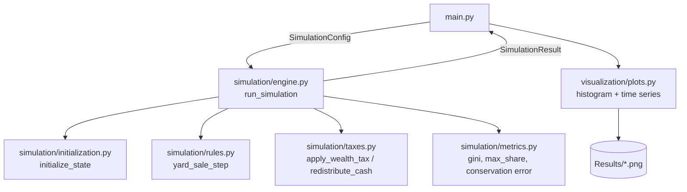
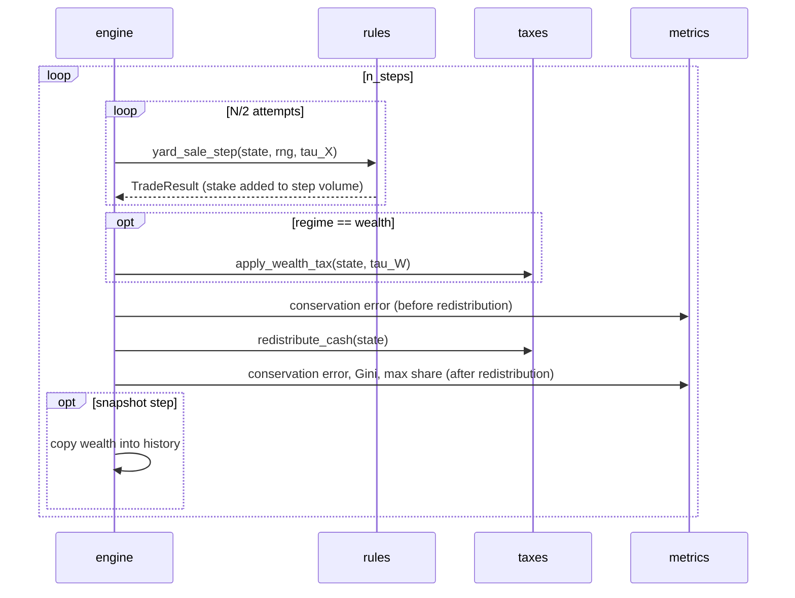

# Design Document

## Overview

A single run executes one configuration (regime, tax rate, seed) from an egalitarian initial state for `n_steps` Monte Carlo steps. Each step performs `N/2` sequential fair trades, then the fiscal operations, then records indicators after redistribution. The run returns the final state, summary metrics, wealth snapshots, per-step series and the measured duration.

The design follows the project rules: configuration is created once in `main.py` and flows down; trade logic lives in `rules.py`; tax mechanisms live in a new module `simulation/taxes.py`; `engine.py` only orchestrates the loop; metrics are stateless; `visualization` uses only what `engine.py` returns.

## Architecture

### Step sequence

## Components and Interfaces

### `config.py`
- `REGIMES = ("none", "wealth", "transaction")`.
- `SimulationConfig` (frozen dataclass), new fields: `regime: str = "none"`, `tax_rate: float = 0.05`.
- `__post_init__` validates `regime` and `tax_rate in [0, 1]`.
- Derived properties so the engine never branches on strings in the inner loop:
  - `wealth_tax_rate` returns `tax_rate` only for `wealth`, else `0.0`.
  - `transaction_tax_rate` returns `tax_rate` only for `transaction`, else `0.0`.

### `simulation/model.py`
- `SimulationState` (mutable): `wealth`, `aversion`, new `cash: float = 0.0`. `total_wealth` excludes cash.
- `SimulationHistory` (frozen): `steps (n_snapshots,)`, `wealth (n_snapshots, n_agents)`.

### `simulation/rules.py`
- `select_agents(n_agents, rng) -> tuple[int, int]`: unchanged (`rng.choice`, no replacement).
- `compute_stake(state, i, j) -> float`: fair rule `min{(1 - beta_i) w_i, (1 - beta_j) w_j}`. Replaces the previous "poorer agent" rule; `compute_poorer_agent` was removed.
- `decide_winner(i, j, rng) -> tuple[int, int]`: unchanged, 50/50.
- `apply_trade(state, winner, loser, stake, transaction_tax_rate=0.0) -> None`: the only mutating trade function. Winner gets `stake - tax`, loser loses `stake`, cash gets `tax`.
- `yard_sale_step(state, rng, transaction_tax_rate=0.0) -> TradeResult`.
- `TradeResult` (frozen): `i, j, stake, winner, loser` (field `poorer` removed).

### `simulation/taxes.py` (new)
- `apply_wealth_tax(state, rate) -> float`: vectorized `taxes = rate * wealth`, computed from one pre-tax state; subtracts from wealth, adds total to cash, returns the amount collected.
- `redistribute_cash(state) -> float`: `share = cash / N`, adds to every agent, sets cash to `0.0`, returns the share.

### `simulation/metrics.py`
- `SimulationMetrics` (frozen): previous fields plus `max_share`, `max_conservation_error`, `min_wealth_observed`, `max_cash`.
- `SimulationSeries` (frozen): `steps, gini, max_share, volume, revenue`, each of shape `(n_steps,)`.
- `compute_gini(wealth)`: unchanged sorted formula. After redistribution `sum(w) = W0`, so normalizing by the current sum matches the methodology.
- `compute_max_share(wealth)`, `compute_conservation_error(wealth, cash, initial_total)`: new pure functions.
- `summarize_wealth(...)`: accepts the run diagnostics.

### `simulation/engine.py`
- `SimulationResult` (frozen): `state, metrics, history, series, duration_seconds`.
- `run_simulation(config) -> SimulationResult`: starts `perf_counter` before RNG creation and stops after building the result objects.
- Per-step revenue `A(t)` is read from `state.cash` right before redistribution. That works for both regimes because the cash starts every step at zero.

### `visualization/plots.py`
- `plot_wealth_distribution(...)`: unchanged.
- `plot_time_series(steps, indicators: dict[str, np.ndarray], output_path, title, show) -> Path`: one panel per indicator, two columns, saved as PNG at 150 dpi.

### `main.py`
- Builds the config, calls `run_simulation`, prints the summary and the duration, saves `distribuicao_riqueza_<tag>.png` and `series_temporais_<tag>.png`. `<tag>` is `none` or `<regime>_tau<rate>`.

## Data Models

| Object | Mutability | Shape / type |
|---|---|---|
| `SimulationConfig` | frozen | scalars |
| `SimulationState` | mutable | `wealth (N,)`, `aversion (N,)`, `cash: float` |
| `SimulationHistory` | frozen | `steps (S,)`, `wealth (S, N)`, `S = n_steps // k + 1 (+1 if final step not multiple of k)` |
| `SimulationSeries` | frozen | 5 arrays of `(n_steps,)` |
| `SimulationMetrics` | frozen | scalars |
| `SimulationResult` | frozen | the four objects above + `duration_seconds: float` |

Memory with defaults: history `31 x 10^4` floats (about 2.5 MB), series negligible.

## Error Handling

- Invalid `regime` or `tax_rate`: `ValueError` in `SimulationConfig.__post_init__`.
- `snapshot_interval < 1`: `ValueError` at the start of `run_simulation`.
- Conservation failures are reported, never corrected.

## Testing Strategy

Verified during implementation (ad-hoc script, `N = 1000`, 20 steps, `tau = 0.2`):

| Check | Result |
|---|---|
| Fair stake = min of available amounts | pass |
| Taxed trade conserves pair wealth + cash | pass |
| `tau_W = 1` then redistribution gives equal wealth, cash 0 | pass |
| All regimes equal when `tau = 0` (same seed) | pass |
| Max `eps_W` per regime | `1.1e-16` to `3.4e-16` |
| Min wealth observed | non-negative in all regimes |
| Full default run (`regime = none`, `N = 10^4`, 300 MCS) | 61.71 s, Gini 0.9229, `eps_W = 1.8e-16` |

`tests/test_rules.py` was updated for the new `compute_stake(state, i, j)` signature. The pytest suite has not been run yet: neither the WSL Python nor the Windows Python has pytest installed.

## Design Decisions

- **Fair rule replaces the poorer-agent rule.** The methodology defines `a_e` as the minimum of both available amounts. The two rules differ when a richer agent has high risk aversion.
- **Tax rates as derived config properties.** The engine passes plain floats into the hot loop; regime `none` reduces to rates of `0`, which also gives the zero-rate equivalence by construction.
- **Redistribution runs in every regime.** It keeps one step sequence for all regimes; with `C = 0` it is a no-op.
- **Single RNG stream.** Kept from the original code. Sharing pair and winner sequences across regimes is deferred to the realizations work.
- **No optimization.** `rng.choice` per trade and the Python loop are kept on purpose (about 40 µs per trade).
