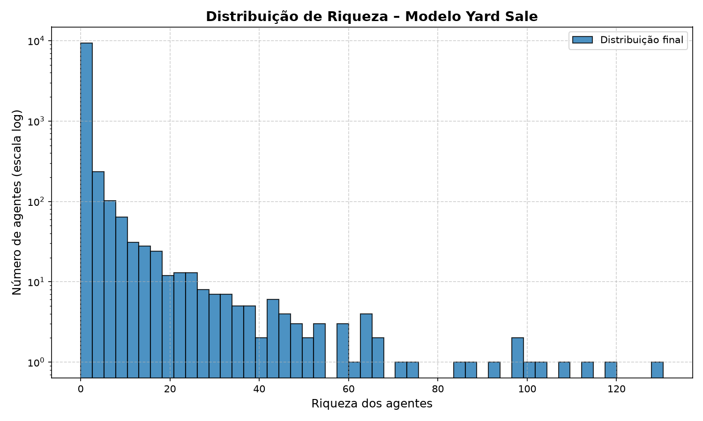
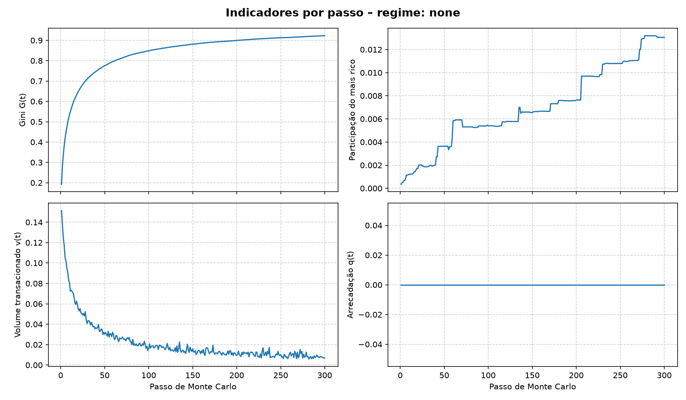

# Yard-Sale com impostos

Simulação baseada em agentes do **modelo Yard-Sale** (econofísica) com **tributação e redistribuição universal**. O código é a parte operacional de um Trabalho de Conclusão de Curso de Engenharia Física. O texto da metodologia, em LaTeX, está em [`metodologia.txt`](metodologia.txt).

## Motivação

No modelo Yard-Sale, agentes que começam com a mesma riqueza fazem trocas aleatórias em que cada lado tem 50% de chance de vencer. Mesmo com trocas justas, a riqueza se concentra em poucos agentes. Este projeto adiciona dois regimes tributários, um sobre a riqueza acumulada e um sobre as transações, ambos com devolução igualitária da arrecadação. O objetivo é comparar o efeito de cada regime sobre a desigualdade (Gini), a concentração no agente mais rico e o volume transacionado.

## O modelo

**População.** `N` agentes (padrão 10 000), todos com riqueza inicial `w_0 = 1`. Cada agente `i` tem um parâmetro de aversão ao risco `β_i`, sorteado de `U[0, 1)` e mantido fixo durante a execução.

**Passo de Monte Carlo.** Um passo corresponde a `N/2` tentativas de troca, executadas em sequência. Cada tentativa:

1. Sorteia dois agentes distintos `i` e `j` de toda a população (sem rede de contatos).
2. Calcula a aposta bruta (regra *fair*), com base no estado imediatamente anterior:
   `a = min{(1 − β_i)·w_i, (1 − β_j)·w_j}`.
3. Sorteia o vencedor com probabilidade 1/2 para cada lado, independentemente de riqueza e aversão.
4. O perdedor perde `a`. O vencedor recebe `(1 − τ_X)·a`. O valor `τ_X·a` vai para o caixa `C`. Sem imposto sobre transações, `τ_X = 0`.

Depois das `N/2` tentativas, o passo continua assim:

1. No regime patrimonial, todos os agentes são tributados ao mesmo tempo: `T_i = τ_W·w_i`, e o total vai para o caixa.
2. O caixa é devolvido em partes iguais, `b = C / N`, e zerado. Esta etapa roda em todos os regimes. Sem imposto, o caixa é zero e a devolução não altera nada.
3. Os indicadores do passo são registrados, depois da redistribuição.

### Regimes tributários

Implementados em [`simulation/rules.py`](simulation/rules.py) (imposto sobre transações) e [`simulation/taxes.py`](simulation/taxes.py) (imposto patrimonial e redistribuição).

| `regime` | Imposto | Onde é aplicado |
|---|---|---|
| `none` | Nenhum. `tax_rate` é ignorada. | |
| `wealth` | `τ_W = tax_rate` sobre a riqueza de cada agente, ao fim de cada passo. | `apply_wealth_tax` |
| `transaction` | `τ_X = tax_rate` sobre o valor recebido pelo vencedor, em cada troca. | `apply_trade` |

Nos regimes `wealth` e `transaction`, `redistribute_cash` devolve toda a arrecadação igualmente a cada passo. Não há custo administrativo, retenção nem redistribuição focalizada.

## Métricas

Definidas em [`simulation/metrics.py`](simulation/metrics.py).

**Resumo final** (`SimulationMetrics`): riqueza total, média, mediana, mínima e máxima; coeficiente de Gini; participação do agente mais rico (`max(w) / Σw`); e três diagnósticos acumulados na execução: erro máximo de conservação, menor saldo individual observado e maior saldo do caixa.

**Séries por passo** (`SimulationSeries`, registradas após a redistribuição):

| Série | Significado |
|---|---|
| `gini` | Gini `G(t)`, pela fórmula com riquezas ordenadas |
| `max_share` | participação do agente mais rico |
| `volume` | volume bruto transacionado no passo, dividido por `W_0` |
| `revenue` | arrecadação do ciclo (o caixa imediatamente antes da devolução), dividida por `W_0` |

O erro de conservação é `|Σw + C − W_0| / W_0`, calculado antes e depois da redistribuição. O código apenas o registra e nunca corrige saldos.

## Instalação

Requer Python 3.10 ou superior.

```bash
python -m venv .venv
source .venv/bin/activate        # Windows: .venv\Scripts\activate
pip install -r requirements.txt
```

Dependências (`requirements.txt`): `numpy>=1.24`, `matplotlib>=3.7`, `pytest>=7.0`.

## Como executar

```bash
make run
```

O alvo cria ou reutiliza o ambiente virtual, executa uma simulação com a configuração padrão, imprime o resumo no terminal e salva duas figuras em `Results/`. Os valores padrão são `N = 10 000` e 1 200 passos; o tempo depende da máquina. Também é possível executar `python main.py` diretamente depois de instalar as dependências.

Para rodar a suíte de testes:

```bash
make test
```

`main.py` não tem argumentos de linha de comando. Para mudar a configuração, edite a linha `config = SimulationConfig()` em `main.py`, por exemplo:

```python
config = SimulationConfig(regime="wealth", tax_rate=0.10)
```

### Parâmetros (`SimulationConfig`)

| Parâmetro | Tipo | Padrão | Descrição |
|---|---|---|---|
| `n_agents` | `int` | `10000` | número de agentes `N` |
| `n_steps` | `int` | `1200` | passos de Monte Carlo |
| `initial_wealth` | `float` | `1.0` | riqueza inicial de cada agente |
| `seed` | `int` | `42` | semente do gerador de números aleatórios |
| `hist_bins` | `int` | `50` | número de bins do histograma |
| `snapshot_interval` | `int` | `10` | intervalo, em passos, entre snapshots da riqueza (deve ser ≥ 1) |
| `results_dir` | `str` | `"Results"` | pasta de saída das figuras |
| `show_plots` | `bool` | `False` | abre as janelas dos gráficos além de salvar |
| `regime` | `str` | `"none"` | `"none"`, `"wealth"` ou `"transaction"` |
| `tax_rate` | `float` | `0.05` | alíquota `τ` do regime escolhido, em `[0, 1]` |

Um `regime` inválido ou uma `tax_rate` fora de `[0, 1]` levanta `ValueError` ao criar a configuração.

### Saídas

Os arquivos recebem o sufixo `<tag>`: `none` para o regime sem imposto, ou `<regime>_tau<alíquota>` nos demais (por exemplo, `wealth_tau0.05`).

- `Results/distribuicao_riqueza_<tag>.png`: histograma da riqueza final, com eixo y em escala logarítmica.
- `Results/series_temporais_<tag>.png`: Gini, participação do mais rico, volume transacionado e arrecadação por passo.

Os snapshots da riqueza (`result.history`) ficam apenas em memória.

Exemplo para o regime `none` com a configuração padrão:





## Experimento comparativo reproduzível

O fluxo experimental separado de `main.py` executa a grade canônica de nove configurações:

- `none`, com alíquota canônica zero;
- `wealth` com `τ ∈ {0.05, 0.10, 0.20, 0.30}`;
- `transaction` com as mesmas quatro alíquotas.

Por padrão, o protocolo usa `R=10`, `N=10000`, 300 passos, janela inclusiva `[150, 300]`, mobilidade com `Δt=50`, snapshots regulares a cada 10 passos e semente-base 2025. O protocolo principal mantém `stability_status=not_assessed` e interpreta seus resultados como **tempo finito**. O piloto de estabilização é um diagnóstico separado: seus resultados não alteram automaticamente esses parâmetros nem transformam as saídas em estimativas estacionárias.

Cada realização recebe streams independentes derivados com `SeedSequence.spawn`. Dentro de uma realização, as nove configurações compartilham exatamente os mesmos parâmetros `β`, a condição inicial igualitária, os pares e os vencedores. Uma chave de desempate própria, fixa por agente e gerada em stream separado, é usada apenas na mobilidade por quintis. Os hashes do protocolo e das entradas comuns permitem auditar o pareamento.

```bash
# Experimento científico completo: 9 cenários × 10 realizações = 90 execuções.
# Sem variáveis, usa EXPERIMENT_ID=main e Results/experiments.
make experiment

# Também é possível escolher um ID explícito.
make experiment EXPERIMENT_ID=principal

# Retoma resultados válidos e executa somente o que falta.
python -m experiments.run_experiment simulate --experiment-id principal

# Recria tabelas e figuras exclusivamente dos dados brutos em disco.
python -m experiments.run_experiment analyze --experiment-id principal

# Smoke rápido com 18 execuções pequenas.
make experiment-smoke RESULTS_ROOT=/tmp/yard-sale-experiments
```

O subcomando `all` executa `simulate` e depois `analyze`. A persistência de NPZ e JSON é atômica. Uma segunda chamada pula somente saídas completas cujos IDs e hashes conferem, sem apagar os resultados existentes. Ao mudar qualquer parâmetro do protocolo, use um novo `EXPERIMENT_ID`; um protocolo incompatível no mesmo ID é recusado.

Cada experimento fica isolado em `Results/experiments/<experiment_id>/`:

```text
protocol.json
manifest.json
raw/realization_NNN/common_inputs.npz
raw/realization_NNN/<configuration_tag>.npz
tables/series_mean_se.csv
tables/metric_summary.csv e metric_summary.md
tables/paired_differences.csv e paired_differences.md
tables/diagnostics.csv
tables/lorenz_mean_se.csv
tables/mobility_matrices.csv
tables/boundary_ties.csv
figures/series_mean_se.png
figures/metrics_vs_tau.png
figures/lorenz_selected.png
figures/mobility_none.png
figures/mobility_wealth_tau0.05.png
figures/mobility_transaction_tau0.05.png
```

As médias de janela são calculadas primeiro em cada realização. A média final e o erro-padrão usam as realizações como unidades independentes, com `EP = std(ddof=1)/sqrt(R)`. As diferenças `wealth − transaction` são calculadas de forma pareada para cada alíquota. As curvas de Lorenz usam cinco cenários predefinidos. A mobilidade usa os três cenários predefinidos na metodologia, preserva a identidade dos agentes e registra empates nas quatro fronteiras dos quintis.

## Piloto de estabilização T/2T

O piloto é um diagnóstico separado da grade exploratória. Ele percorre uma única trajetória comum até `2T` para cada realização e cenário. `T` é o prefixo exato da mesma trajetória, portanto `T` e `2T` não são amostras independentes e não existe uma duração separada inventada para `T`.

Os parâmetros padrão do alvo `pilot` são **provisórios**: `R=10`, `N=10000`, `T=300`, `2T=600`, semente-base 2025, riqueza inicial 1, snapshots a cada 10 passos e os nove cenários canônicos. Cada realização recebe uma semente derivada de `base_seed` por `SeedSequence.spawn`. Dentro da realização, os nove cenários usam exatamente os mesmos `β`, pares, vencedores e condição inicial; uma chave aleatória fixa por agente é usada para desempates da mobilidade. Rode o piloto explicitamente:

```bash
make pilot PILOT_ID=pilot-2026-11-21 STABILITY_CONFIG=config/stability_margins.example.json

# Integração rápida, com os nove cenários, R=2, N=20 e T=8.
make pilot-smoke PILOT_RESULTS_ROOT=/tmp/yard-sale-pilot-smoke PILOT_ID=smoke

# Recria a análise sem simular e somente a partir dos dados já no disco.
make analyze-pilot PILOT_ID=pilot-2026-11-21
```

O alvo `pilot` executa `all`: retoma ou completa os dados brutos e depois gera a análise. Ele aceita as substituições `PILOT_ID`, `PILOT_RESULTS_ROOT`, `STABILITY_CONFIG`, `PILOT_R`, `PILOT_N`, `PILOT_T` e `PILOT_SEED`. O alvo `analyze-pilot` usa somente `PILOT_ID` e `PILOT_RESULTS_ROOT`, pois não simula nem recebe parâmetros de simulação. O alvo `pilot-smoke` fixa `R=2`, `N=20` e `T=8`; nele, `PILOT_ID`, `PILOT_RESULTS_ROOT`, `STABILITY_CONFIG` e `PILOT_SEED` continuam disponíveis. O smoke verifica a integração, mas não fornece evidência científica de estabilização.

### Margens de estabilidade

Copie e adapte [`config/stability_margins.example.json`](config/stability_margins.example.json). O arquivo é JSON estrito, versão 1, e deve conter exatamente estes campos:

| Campo | Regra |
|---|---|
| `schema_version` | inteiro `1` |
| `K` | inteiro maior ou igual a `2` |
| `confidence` | `0.90`, `0.95` ou `0.99` |
| `tail_fraction` | número finito em `(0, 1]`, fração final usada |
| `joint_status` | exatamente `all_metrics_all_comparisons` |
| `margins.gini.absolute` | margem absoluta positiva para Gini |
| `margins.max_share.absolute` | margem absoluta positiva para participação máxima |
| `margins.volume.absolute` | margem absoluta positiva para volume |
| `margins.volume.relative` | margem relativa positiva para volume |

Não são aceitos campos extras ou ausentes. Para cada horizonte `H`, a análise calcula `width = floor(floor(H * tail_fraction) / K)` e usa as últimas `K * width` observações em `K` janelas inclusivas, iguais, sucessivas e não sobrepostas. Calcula primeiro a média temporal em cada realização e depois a média e o erro-padrão entre realizações (`ddof=1`). Compara as janelas adjacentes em `T` e em `2T`, além da janela final de `T` com a janela final de `2T`, por diferenças pareadas. O intervalo de confiança bilateral Student-t precisa caber inteiro dentro da margem para a comparação passar. Para volume, a margem efetiva é `max(absolute, relative * max(abs(mean_a), abs(mean_b)))`.

A regra dos status é aplicada por métrica:

- `stabilized`: todas as comparações válidas passaram;
- `finite_time`: pelo menos uma comparação falhou claramente;
- `inconclusive`: nenhuma falhou claramente, mas alguma comparação ficou ambígua;
- `not_assessed`: não há avaliação válida suficiente.

O `joint_status` do cenário exige que Gini, participação máxima e volume estejam todos em `stabilized`. Se houver `not_assessed`, o conjunto fica `not_assessed`; caso contrário, `finite_time` prevalece sobre `inconclusive`, que prevalece sobre `stabilized`. O diagnóstico não prova equilíbrio matemático, mesmo quando o status é `stabilized`.

### Dados, retomada e artefatos

Cada piloto fica isolado em `Results/pilots/<pilot_id>/` ou na raiz passada em `PILOT_RESULTS_ROOT`. Os artefatos incluem `protocol.json`, `stability_margins.json`, `manifest.json`, os dados brutos 2T em `raw/realization_NNN/` (`common_inputs.npz` e um NPZ por cenário), as tabelas em `tables/`, as figuras em `figures/`, `report.md` e `timing.json`. O relatório gera as médias por realização, os resumos, as comparações e os status; `timing.json` registra a duração de simulação, análise e, em `all`, do comando completo.

A retomada não apaga resultados. Ela reutiliza somente NPZ válidos, conferindo IDs, hashes, protocolo, margens e entradas aleatórias comuns. `make analyze-pilot` e o subcomando `analyze` reanalisam exclusivamente o disco e nunca executam a simulação. Se o protocolo, as margens ou qualquer entrada mudar, use um novo `PILOT_ID` para manter os artefatos anteriores intactos; um ID existente com protocolo incompatível é recusado.

O custo é `R × 9` trajetórias até `2T`, ou 90 execuções no padrão. Como referência aproximada, um piloto local com `N=10000`, `R=10`, `T=1200` e `2T=2400` registrou cerca de 3 horas e 10 minutos de parede para simular e alguns minutos para analisar. O tempo varia com hardware, carga e armazenamento. O piloto científico completo é longo; use `pilot-smoke` apenas para verificar o fluxo, não para substituir o piloto.

Os diretórios de pilotos que já existirem em `Results/pilots/` são resultados locais e podem estar fora do Git ou ausentes em outra cópia. Para confirmar o estado de uma execução, confira o `protocol.json`, o `manifest.json` e o `timing.json` do próprio `pilot_id`; a documentação não presume que um horizonte específico tenha terminado.

## Docker

O `Dockerfile` usa `python:3.11-slim`, instala `requirements.txt` e executa `python main.py` com o backend `Agg` do matplotlib, sem janela gráfica. Para recuperar as figuras no host, monte a pasta `Results`:

```bash
docker build -t yard-sale-com-impostos .
docker run --rm -v "$(pwd)/Results:/app/Results" yard-sale-com-impostos
```

## Testes

```bash
make test
```

A suíte cobre regras de troca e impostos, invariantes do motor, métricas, aleatoriedade comum, persistência retomável, estatística, Lorenz, mobilidade e a integração experimental pequena. Nenhum teste executa o experimento científico de 90 execuções.

## Reprodutibilidade

A execução simples mantém o gerador `np.random.default_rng(config.seed)` e a API `run_simulation(config)`. O fluxo experimental torna os números aleatórios comuns explícitos em `common_inputs.npz`, usa streams independentes por realização e valida hashes antes de retomar ou agregar. Todo NPZ é lido com `allow_pickle=False`.

## Licença

Distribuído sob a licença Apache 2.0. Veja o arquivo [`LICENSE`](LICENSE).

## Citação e autoria

- **Autor:** _a preencher_
- **Orientador(a):** _a preencher_
- **Instituição:** _a preencher_
- **Ano:** _a preencher_

```bibtex
@misc{yard_sale_com_impostos,
  author = {{A preencher}},
  title  = {Yard-Sale com impostos: simulação baseada em agentes com tributação e redistribuição},
  year   = {A preencher},
  url    = {https://github.com/brianton90/yard-sale-com-impostos}
}
```
